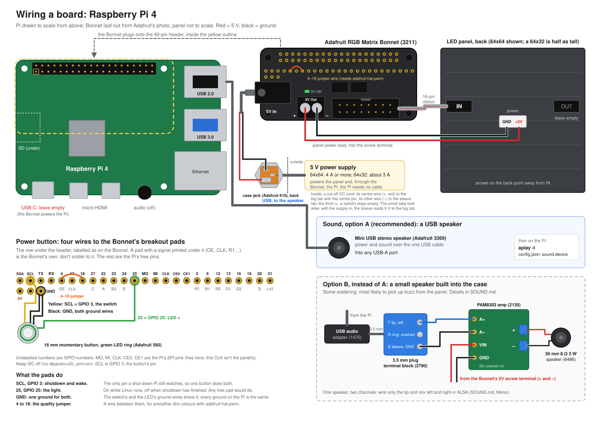
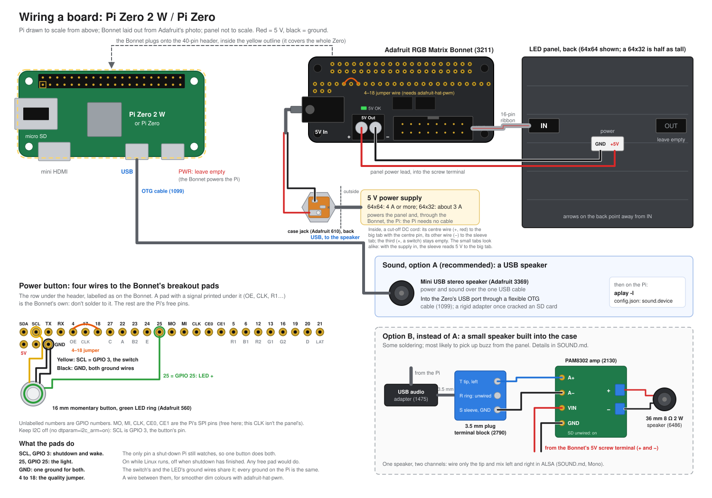

# Hardware

What goes into a board, how it fits together, and the settings each of ours runs with. Software
setup is in the main [README](../../README.md).

## How it fits together

```
                 5 V power supply
                   │ (+)  │ (−)
                   ▼      ▼
 ┌──────────────────────────────────────┐     ribbon cable (HUB75)     ┌──────────────────────┐
 │ Adafruit RGB Matrix Bonnet           ├─────────────────────────────►│ RGB LED panel        │
 │  • power terminal / barrel jack      │                              │ 64x32 or 64x64       │
 │  • green power-good LED              ├──── panel power lead ───────►│                      │
 │  • feeds the Pi 5 V through a diode  │                              └──────────────────────┘
 └──────────────┬───────────────────────┘
                │ sits on the 40-pin GPIO header
 ┌──────────────┴───────────────────────┐
 │ Raspberry Pi (Pi 4 or Pi Zero 2 W)   │   USB ──► USB speaker (optional, for show sound)
 │  micro SD card: Raspberry Pi OS      │
 └──────────────────────────────────────┘
```

One supply powers everything: the Bonnet passes 5 V to the panel and, through its diode, to the Pi.
The Pi needs no power cable of its own.

## Wiring diagrams

Everything connected, for each kind of Pi: the Bonnet, panel and power supply, the power button,
and both ways to add sound. The Pis are drawn to scale from above, so the ports are where you'll
find them.

- [Raspberry Pi 4](wiring-pi4.svg)
- [Pi Zero 2 W / Pi Zero](wiring-pi-zero.svg): the speaker goes into the **USB** port through an
  OTG cable.

On both, the power button's wires solder to the Bonnet's breakout pads, the labelled row under
its header, drawn in each diagram exactly as printed on the board.





To change one, edit `tools/draw_wiring.py` (not the SVGs) and run `python3 tools/draw_wiring.py`.

## Parts

A shopping list with quantities, example parts and prices is in [BOM.md](BOM.md).

| Part | Notes |
|---|---|
| **Raspberry Pi** | A Pi 4 is fastest. A Pi Zero 2 W works and is what most of ours use, but it boots slowly (up to about 30 s to the first picture) and runs the busiest animations more slowly. Every character and show logs its frame rate. |
| **micro SD card** | 16 GB or more, with Raspberry Pi OS Bookworm (Lite is enough). The app targets Python 3.11, Bookworm's. |
| **Adafruit RGB Matrix Bonnet** ([3211](https://www.adafruit.com/product/3211)) | Drives the panel from the Pi's GPIO. Solder its **GPIO 4–GPIO 18 jumper** (Adafruit's "quality" option: a short wire between the **4** and **18** breakout pads, under the header) and run `--led-gpio-mapping=adafruit-hat-pwm`: it removes flicker on dim screens. With the jumper but the plain `adafruit-hat` mapping, the jumper does nothing. |
| **HUB75 RGB LED panel** | 64x32 or 64x64; other sizes aren't supported. Some panels need a chipset setting, like the Waveshare P5 64x32 (`--led-panel-type=FM6126A`; see the main README). A 64x64 panel at 1/32 scan uses the Bonnet's E address line. |
| **5 V power supply** | Into the Bonnet's screw terminal or barrel jack. A 64x32 panel needs about 3 A, a 64x64 about 4 A or more: the screens are mostly dark, but bright white frames (like the fireworks' final flash) pull far more than the average. Buy a supply with headroom. |
| **Ribbon cable and panel power lead** | Usually included with the panel. |
| **Case** | 3D-printed in PLA. PLA softens around 55–60 °C, so keep it off the Pi's hottest spots and leave some airflow. |

### Optional

| Part | Guide |
|---|---|
| **Speaker**, for the fireworks show's soundtrack | [SOUND.md](SOUND.md): a plug-in USB speaker (recommended), or a small speaker and amp built into the case. It must be USB: the Pi's own audio and I2S amps both clash with the matrix and the Bonnet. |
| **Power button** with a light, for safe shutdown and wake | [POWER.md](POWER.md): one momentary button on GPIO 3, its light on GPIO 25. |
| **Panel-mount 2.1 mm DC jack** ([610](https://www.adafruit.com/product/610)) and a DC cord to cut | The supply plugs into the back of the case instead of the Bonnet, so the board never has to come out. Mount the jack in the case wall (it takes a wall up to 8 mm thick, held by its nut) and cut the far end off a DC cord with a 2.1 mm centre-positive plug, like the Bonnet's jack takes. On the jack's back are three solder eyes. Solder the cord's centre (+) wire to the **big tab**, the one the centre pin comes through, and its other (−) wire to the **sleeve tab**. The third tab is a switch contact; leave it empty. The two small tabs look alike: with the supply plugged in, the sleeve is the one that reads 5 V against the big tab. Then plug the cord into the Bonnet's 5V In. Get the polarity right: with the supply plugged into the case jack, a multimeter on the inside plug must read +5 V on the centre pin, before it goes near the Bonnet. Both the jack and the cord must be rated for the supply's current (5 A for a 64x64), and use 20 AWG wire or thicker. |
| **USB OTG cable**, Pi Zero only | For a USB speaker: into the Zero's **USB** port, not PWR. Use a flexible cable, not a rigid adapter: a rigid one fitted into a tight case once cracked a board's SD card. |

The Bonnet's own green power-good LED already shows when 5 V is reaching it. If the case hides it,
a hole or a short clear-PLA light pipe over it gives an instant "power is on" light for free.

## Our boards

Each board's settings come from [boards.json](../../boards.json), keyed by its hostname, overridden by
`config.json`'s `matrix` section, then by command-line flags.

| Board | Pi | Panel | Settings beyond `adafruit-hat-pwm` | Sound |
|---|---|---|---|---|
| Disneypi | Pi 4 | 64x64 | `led_slowdown_gpio=4`, `led_brightness=100`, `led_pwm_lsb_nanoseconds=200` | |
| MickeyPi | Pi Zero | 64x64 | `led_slowdown_gpio=2` | USB speaker |
| TinyPi | Pi Zero 2 W | 64x64 | `led_slowdown_gpio=2` | USB speaker (Jieli UACDemoV1.0) |
| PlutoPi | Pi Zero | 64x32 | `led_slowdown_gpio=2`, `led_pixel_mapper=Rotate:180` (mounted upside down) | |
| ZeroPi | Pi Zero | 64x32 | `led_slowdown_gpio=2` | |

Still to fill in for each board: the panel make and model, and the power supply's rating.

## Pins

The Bonnet uses GPIO 4, 5, 6, 12, 13, 16, 17, 20, 21, 22, 23, 26 and 27, plus GPIO 24 (the panel's E
line) on a 64x64 panel and GPIO 18 with the quality jumper. That leaves GPIO 2, 3 (I2C), 14, 15
(UART), 19, 25 and the SPI pins (7–11) free. The power button uses GPIO 3 and GPIO 25. Don't turn on
the 1-Wire interface: it defaults to GPIO 4, which the panel uses. From Adafruit's
[Bonnet pinouts](https://learn.adafruit.com/adafruit-rgb-matrix-bonnet-for-raspberry-pi/pinouts).

## Building one

This project grew out of [MLB-LED-Scoreboard](https://github.com/MLB-LED-Scoreboard/mlb-led-scoreboard),
which runs on the same hardware: a Raspberry Pi, the Adafruit RGB Matrix Bonnet and a HUB75 panel. Its
README and wiki cover assembling the Bonnet, the panel and the power supply step by step, so follow its
hardware guide to put a board together, then come back here for the parts that are specific to this
project.
